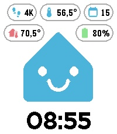
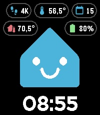

# Casita Watchface — Documentation

A Pebble watchface that shows the [Home Assistant](https://www.home-assistant.io/)
"Casita" mascot with a mood that changes across the day, above a large clock.
When the watch loses its Bluetooth link to the phone, Casita switches to a
"disconnected" expression.

The watch side is native **C** (Pebble SDK); the phone side (settings page,
weather, Home Assistant) is **TypeScript** running in PebbleKit JS. Builds are
orchestrated with **Bun** via **Mise**. Artwork ships as **Pebble Draw Command**
(`.pdc`) vector images generated from SVG by a self-contained Python converter.

## Supported watches

| Watch | Platform | Display | Notes |
| --- | --- | --- | --- |
| Pebble Time 2 | `emery` | 200×228, colour | Large badges |
| Pebble Round 2 | `gabbro` | 260×260 round, colour | Large badges |
| Pebble Time / Time Steel | `basalt` | 144×168, colour | Compact badges |
| Pebble Time Round | `chalk` | 180×180 round, colour | Compact badges |
| Pebble 2 | `diorite` | 144×168, black & white | Compact badges, 1-bit art |
| Pebble 2 Duo | `flint` | 144×168, black & white | Compact badges, 1-bit art |

The original Pebble / Pebble Steel (`aplite`) is not supported: 24 KB for code
and heap and no Pebble Health.

Screens narrower than 200 px use compact badges (14 px icons, Gothic 14, tighter
padding) so three still fit on a row. Casita is a vector image and scales to
the free space on every screen. On the black-and-white watches Casita is a
black house with white features (inverted on the dark theme), the pill borders
are black or white instead of gray, and the battery badge shows the charge as
bars instead of colour.

## Screenshots

| Light theme | Dark theme |
| :---: | :---: |
|  |  |

## Expressions

| Local time    | Expression   | Resource                | Body color            |
| ------------- | ------------ | ----------------------- | --------------------- |
| 06:00 – 11:59 | Normal       | `CASITA_NORMAL`         | blue `#18bcf2`        |
| 12:00 – 14:59 | Happy        | `CASITA_HAPPY`          | blue `#18bcf2`        |
| 15:00 – 20:59 | Grinning     | `CASITA_GRINNING`       | blue `#18bcf2`        |
| 21:00 – 05:59 | Sleeping     | `CASITA_SLEEPING`       | gray `#999999`        |
| temp ≥ 30 °C  | Sweating     | `CASITA_SWEATING`       | blue `#18bcf2`        |
| any (BT down) | Disconnected | `CASITA_DISCONNECTED`   | orange `#f7931e`      |

"Disconnected" means the watch has no Bluetooth connection to the phone app
(`watch.connected.app`); it overrides every other expression. When connected, a
last weather reading of **30 °C or hotter** (from the Temperature badge's
Open-Meteo fetch) shows the **Sweating** face regardless of the time of day;
otherwise the time-of-day expression applies. The facial features stay off-white
(`#f2f4f9`) in every expression; only the body color changes.

The clock follows the watch's 12/24-hour preference: 24h uses a leading-zero
hour (`07:05`), 12h drops it (`7:05`, with `12` for midnight/noon).

## Settings

The watchface has a settings page, opened from the **Casita** entry in the
Pebble/Rebble phone app ("Settings"). Options:

- **Appearance — Light / Dark / Auto:** sets the background to white (with black
  clock) or black (with white clock). **Auto** follows the sun — light between
  local sunrise and sunset and dark otherwise, using sunrise/sunset times fetched
  for your location from Open-Meteo (the same source as the temperature badge).
  If the phone can't supply sun times yet, Auto falls back to Dark. Default is
  **Dark**.
- **Badges — Date / Temperature / Steps / Battery / Home temperature:**
  individually show or hide the top badges (all default to **on**), and reorder
  them with the ▲ ▼ buttons to set their priority. The first badge sits in the
  top-right corner and the others fill leftwards from it; the top row takes
  three, and any further badges drop to a second row pinned to the two corners,
  leaving the middle free for Casita's roof peak so Casita keeps its full size.
  On the round Pebble the rows hold one, two and two badges: one centred at
  the top, two centred below it, the rest at the circle's edge beside the roof. The **Home temperature** badge only appears once
  Home Assistant is connected and a sensor is chosen (see below).

How it works:

- The config UI is a self-contained `data:` HTML page; no external hosting
  needed. Its markup lives in `src/pkjs/config.eta` ([Eta](https://eta.js.org/)
  template) and is rendered to a plain string at build time — Eta runs only at
  build, nothing ships to the phone. The current preferences are injected at
  runtime as a JSON blob (replacing a `__CONFIG__` token) and applied to the
  form by a small inline script. Tapping **Save** hands the choices to the app by
  navigating to `pebblejs://close#<json>`. That navigation is the platform's
  *only* channel back to the watch (there is no live/continuous link), so closing
  the page is what actually applies the settings — hence Save closes the page.
- On save, the phone persists the choices (`localStorage`) and sends them to the
  watch over AppMessage: `THEME` (0 = light, 1 = dark), `SHOW_WEATHER`,
  `SHOW_STEPS`, `SHOW_DATE` and `SHOW_BATTERY` (0 = off, 1 = on),
  and `BADGE_ORDER` (the badge priority order as a compact code string,
  e.g. `dwsb` = date, weather, steps, battery). The one message in the other
  direction is `REFRESH`, which the watch sends to ask for fresh data (see
  [Refresh cadence](#refresh-cadence)).
- The watch persists every preference in its own `localStorage`, so it renders
  with the right colors and badges immediately on launch, before the phone
  reconnects.

## Home Assistant connection

The settings page can connect to your Home Assistant instance to add a second,
home temperature badge. Home Assistant has its own **dedicated page** inside
settings, reached from a distinct **Connect / Manage Home Assistant** button
(with a status dot) — separate from the main **Save** button.

Setup, in the phone **Settings** page:

- Tap **Connect Home Assistant** to open the Home Assistant page, enter your
  Home Assistant URL, and tap **Log in to Home Assistant**. Home Assistant's own
  login screen opens — you never create or paste a token by hand.
- **Use a remote URL** (e.g. your [Nabu Casa](https://www.nabucasa.com/) address
  or a reverse-proxied `https://` URL) so the watch works everywhere, not just on
  your home Wi‑Fi.
- **Recommended:** create a dedicated Home Assistant user for the watch with
  limited permissions instead of using your admin account.

After you log in, Home Assistant's OAuth screen forces **Settings to close**.
**Reopen Settings** from the Pebble app — it drops you straight back into the
Home Assistant page, now **Connected**, showing the number of available
temperature sensors and a searchable **entity picker** to choose the home
temperature sensor (each sensor's friendly name and area, like the Home
Assistant frontend picker), plus a **Disconnect** button. Pick a sensor, go
back, and Save. When a sensor is selected the page collapses to show just that
sensor (name, area and its **current value**) with a **Remove sensor** button,
and a **Home temperature** badge becomes available in the main badge list —
reorderable and toggleable like the others.

**The Home Assistant page has no Save button of its own** — connect/disconnect
and the chosen sensor are only applied when you tap the main **Settings → Save**,
exactly like every other setting. Tapping **Disconnect** immediately flips the
page to the disconnected (connect) view — with a "will disconnect when you save"
note and a **Keep connected** undo — but nothing is actually cleared until you
save Settings. A fresh login is likewise a *draft*: the connected page shows a
"Not saved yet" hint. Because the OAuth login has to close the settings to run,
that draft **persists across reopens** (the login isn't thrown away just because
the page reopened) until you either **Save** it or
**Disconnect** and Save.

How it works (all phone-side):

- Home Assistant uses IndieAuth-style OAuth2: the `client_id` must be a public
  `https` page whose host matches the `redirect_uri`. A tiny static page hosted
  on GitHub Pages (`docs/index.html` + `docs/callback.html`, served at
  `https://wendevlin.github.io/pebble-casita-watchface/`) fills that role — it
  just receives `?code=&state=` from Home Assistant and bounces it back to the
  app via `pebblejs://close#…`.
- The config webview navigates to `<ha-url>/auth/authorize?…`; after login,
  `callback.html` returns the code to pkjs. pkjs (`src/pkjs/index.ts`) exchanges
  it at `<ha-url>/auth/token` for access/refresh tokens (persisted in
  `localStorage`), then fetches the temperature sensors via
  `POST <ha-url>/api/template` (a Jinja template that resolves each sensor's
  friendly name and area via `area_name()`), falling back to
  `GET <ha-url>/api/states` (name only) if templating is unavailable. The sensor
  list is cached in `localStorage` so the settings page can render the picker
  immediately, and refreshed in the background on open.
- The config page is a small two-view SPA (main settings + the Home Assistant
  page); switching views is client-side, so opening the Home Assistant page does
  **not** close settings. Only **Save** and the **login** redirect navigate to
  `pebblejs://close#…`. Connect/disconnect are staged as an in-page draft and
  sent to pkjs as a `haConnected` boolean in the Save payload; pkjs commits or
  clears the connection accordingly. A completed login is kept as a connected
  draft (tokens persisted) until it is saved or explicitly disconnected.
- The OAuth URL building, state encoding, token bodies, the sensor template,
  sensor-list parsing/search and the state→°C conversion are pure functions in
  `src/pkjs/ha.ts` (unit-tested in `tests/ha.test.ts`). The config
  webview re-implements the tiny base64url/state and search bits inline because
  it runs in its own sandbox and cannot import that module.
- **Home temperature reading:** once connected with a sensor selected, pkjs
  reads `<ha-url>/api/states/<id>` on every refresh (see
  [Refresh cadence](#refresh-cadence)) and sends the value to the watch as
  `HA_TEMP` (tenths of a degree Celsius, converted from °F when the sensor
  reports Fahrenheit). A token about to expire is refreshed first; a `401` on the
  request triggers one refresh-and-retry. An earlier live WebSocket feed was
  dropped: every pushed reading is an AppMessage that wakes the watch, and a
  room temperature does not need that.

## Refresh cadence

Weather, sun times and the Home Assistant reading all refresh together, every
**30 minutes**, and the **watch** drives it. PebbleKit JS runs inside the Pebble
mobile app, and its timers stall whenever the phone freezes that app in the
background — so a phone-side `setInterval` alone leaves a stale value on the
watch for hours (the symptom: a morning temperature that never changes). An
inbound AppMessage does wake the JS, so:

- `main.c` sends `REFRESH` from its minute tick whenever the minute of the
  hour is a multiple of 30, and once more whenever the phone link comes back
  (after a night in airplane mode, say). The send is skipped while disconnected
  and any outbox error is ignored — the next interval retries. Reconnect
  requests are skipped within 10 minutes of the last one, so a flapping
  Bluetooth link doesn't trigger a refresh per reconnect.
- `index.ts` handles that message by calling `refreshAll()`: the Open-Meteo
  fetch (weather + sunrise/sunset) and the HA sensor GET. The same function runs
  on launch and on Save. Automatic refreshes (launch, `REFRESH`) closer than
  10 minutes to the previous one are skipped: the watchface — and with it the
  phone script — restarts every time the user comes back from the launcher or
  the timeline, and each refresh costs a GPS fix, two HTTP requests and up to
  three AppMessages that wake the watch. Save always refreshes. There is
  deliberately no phone-side timer: it would stall in the background anyway,
  and while the app is awake it would only double the traffic against the
  watch's own cadence.
- **Phone → watch pushes are serialised.** Two pushes sent back to back can
  silently drop the first (observed in the emulator: weather lost behind the
  sun times).
  All pushes therefore go through a small queue in `index.ts` that waits for the
  previous message's ack before sending the next, and weather + sun times travel
  in one message — which also wakes the watch once instead of twice.

## Badges

Badges render along the top of the face in the priority order set on the
settings page (default: date, temperature, steps, battery, home). Every row is
filled **from right to left**: the first badge is the rightmost of the top row,
the next sits to its left, and so on, so the top-priority badge stays put no
matter how many others are enabled. The row planning is the pure, unit-tested
`layout_badges()` in `src/c/logic.c`:

- **Rectangular:** the first row hugs the right edge and takes
  the first **three** badges (a wide trio may run past the left edge; accepted).
  Badges four and five go on a second row pinned to the **corners** — four in
  the bottom-right, five in the bottom-left — so the middle of that row stays
  clear. Only one row's worth of vertical space is reserved, so Casita keeps its
  full size: because it's a little house, its triangular roof leaves the top
  corners empty, the corner badges sit in that space and the roof peak rises
  between them. (The sleeping and disconnected expressions fill those corners,
  so they reserve the full stack and shrink Casita instead.)
- **Round:** the circle is narrow at the top and wide just
  below, so the stack is **1 + 2 + 2**. The first badge sits alone, centred, in
  the narrow top row; badges two and three form a centred pair on the second row
  (badge 2 on the right); badges four and five go on a third row pinned to the
  circle's edge at that height — four on the right, five on the left — with the
  middle clear. The first two rows are reserved, so Casita sits below them; the
  third row overlays the roof corners just like the rectangular second row
  (the roof rises at 45°, so at the bottom of that row it is about 40 px wide,
  leaving room for even the widest temperature pill on each side).

Each badge is a rounded pill with an
[MDI](https://pictogrammers.com/library/mdi/) icon and a value:

| Badge       | Icon (MDI)       | Source                              | Format                                        |
| ----------- | ---------------- | ----------------------------------- | --------------------------------------------- |
| Date        | `calendar-blank` | The watch clock                     | Day of month, e.g. `14`                       |
| Temperature | `thermometer`    | Fetched by the phone (Open-Meteo)   | One decimal, no unit letter, e.g. `24,8°`     |
| Steps       | `shoe-print`     | Pebble Health on the watch          | `56` (<100), `0,4K` (100–999), `12K` (≥1000)  |
| Battery     | `battery`        | The watch battery                   | Whole percent, e.g. `85%`; icon coloured by level |
| Home temp   | `home-thermometer` | A Home Assistant sensor (phone)   | One decimal, no unit letter, e.g. `21,3°`      |

- **Weather** is fetched by `src/pkjs/index.ts` using the phone's location and
  the keyless [Open-Meteo](https://open-meteo.com/) API on every refresh (see
  [Refresh cadence](#refresh-cadence)). The temperature is sent to the watch in
  tenths of a degree Celsius via the `WEATHER_TEMP` key. The last successful
  position is remembered, so when the phone refuses a fresh fix in the
  background the weather is still updated for the last known place.
- **Stale readings:** the watch records when each temperature (weather and
  Home Assistant) arrived. A reading older than **1 hour** — the phone is out
  of range, or refreshes keep failing — shows as `--` (the badge stays so the
  layout doesn't jump) and no longer triggers the sweating face. The next
  reading restores it immediately.
- **Units (°C/°F)** are decided on the watch from
  `health_service_get_measurement_system_for_display()` (walked distance),
  which mirrors the Pebble app's *units* setting (imperial → °F, otherwise °C).
  The value is converted accordingly; the unit letter itself is not shown (the
  badge displays just the number and a degree sign, e.g. `24,8°`).
- **Steps** are read directly on the watch via
  `health_service_sum_today(HealthMetricStepCount)` and refresh every minute. If
  Health is unavailable (no permission / unsupported) the badge is hidden.
- **Battery** is the watch's own charge level (`battery_state_service_peek()`,
  read on every minute redraw), shown as a whole percent. Its icon is colour-coded by level: green at ≥ 70%, orange at
  ≥ 30%, red below 30% (three pre-tinted variants generated from the one
  `battery.svg`; the black-and-white watches use MDI `battery-low/medium/high`
  instead, showing one, two or three bars). The tints are the fully saturated palette entries
  `GColorGreen` (`#00ff00`), `GColorChromeYellow` (`#ff9800` → 255,170,0) and
  `GColorRed` (`#ff0000`): the converter truncates to 2 bits per channel, and the
  muted Material green that resulted from `#4caf50` (85,170,85) read as grey on
  the real Pebble Time 2 display even though it looks green in the emulator.
- **Date** shows the current day of month, read from the watch clock and
  refreshed every minute.
- **Home temperature** shows a Home Assistant sensor's reading, fetched by the
  phone on every refresh (see the Home Assistant section above) and sent in
  tenths of a degree Celsius via the `HA_TEMP` key. Like the weather badge it is displayed in °C/°F per the watch's
  own units setting, with the same text colour as the other badges, but its
  **icon** is a distinct **deep-orange** (baked into the icon) so it reads apart
  from the blue Open-Meteo thermometer. The badge only appears when Home
  Assistant is connected, a sensor is chosen, and a reading has been received.

The MDI icons are rasterized to PNG by the `resources` script (see below); the
sources live in `mdi-svgs/` with an accent fill baked in.

**Colors** — the color Pebble renders only 2 bits per channel (64 colors), so
the palette uses the named colors directly: white background and pill fill with
a `GColorLightGray` border (light theme), black background and pill fill with a
`GColorDarkGray` border (dark theme). The pill fill matches the background on
purpose — the badge is defined by its border (2 px, 1 px on compact badges). On
black-and-white watches the border is black (light) or white (dark).

**Sharpness** — the badge icons are rasterized offline at exactly the size the
watch draws them (`ICON_SIZE_LARGE` 20 px, `ICON_SIZE_SMALL` 14 px) into PNGs
with anti-aliased alpha, and the watch blits them 1:1 (`GCompOpSet`). The
black-and-white watches get a black symbol on a transparent background, which
the SDK stores as a 1-bit palette bitmap; the watch recolours the symbol's
palette entry to the theme's text colour, so one bitmap serves both themes. That keeps holes (the calendar page, the
thermometer channel) — which vector draw commands cannot express — and gives
smooth edges. The JS version scaled 24 px integer-point PDC icons down at
runtime, which rounded every vertex to a whole pixel and filled the holes in.
Casita stays a vector PDC (it is scaled for the Quick View) with *precise
paths* (13.3 fixed point, 1/8 px) for smoother anti-aliased curves.

## Battery life

The watch side is plain C with no JavaScript VM on the watch. It only wakes for
the minute tick (`MINUTE_UNIT`, which also refreshes the battery and steps
badges — there is no separate battery subscription), phone connect/disconnect
and inbound AppMessages. Each wake is at most one layer redraw, and an
AppMessage whose values are unchanged (the phone re-sends all settings on every
launch) causes neither a flash write nor a redraw. The face
deliberately does no per-second work: an earlier *show seconds while the
backlight is lit* feature was removed because waking 60 times a minute is the
largest avoidable drain a watchface can have.

## Layout

```
.
├── casita-svgs/            # Source SVG artwork (design assets)
├── mdi-svgs/               # MDI badge icons (accent fill baked in)
├── resources/casita/       # Generated Casita .pdc images (`bun run resources`)
├── resources/icons/        # Generated badge .pdc icons (`bun run resources`)
├── src/
│   ├── c/
│   │   ├── main.c          # Watchface: window, drawing, services, AppMessage, storage
│   │   ├── logic.c         # Pure expression/time/badge logic (host unit-tested)
│   │   └── logic.h
│   └── pkjs/               # PebbleKit JS (phone side: settings + weather + HA)
│       ├── index.ts        #   entry; bundled to index.js by `bun run build:pkjs`
│       ├── ha.ts           #   pure Home Assistant OAuth helpers (unit-tested)
│       ├── config.eta       #   settings page markup (Eta template)
│       └── pebblekit.d.ts  #   typings for the injected `Pebble` global
├── docs/                   # GitHub Pages OAuth client_id + callback (HA login)
│   ├── index.html          #   OAuth client_id page
│   └── callback.html       #   returns the auth code to the app via pebblejs://close
├── tests/c/test_logic.c    # Host C unit tests for logic.c (`bun run test:c`)
├── tests/resources.test.ts # `bun test` guard: PDCs are precise, icons are ICON_SIZE
├── tests/ha.test.ts        # `bun test` unit tests for pkjs/ha.ts
├── tools/svg2pdc.py        # Self-contained SVG -> PDC converter (Casita)
├── tools/svg2png.py        # Self-contained SVG -> anti-aliased PNG rasterizer (icons)
├── tools/build-resources.ts # Job table: which SVGs become which .pdc/.png, in which tint
├── tools/render-config.ts  # Renders config.eta -> config-html.ts at build time
├── tools/emulator-screenshots.sh # Scripted emulator scenarios -> screenshots
├── tsconfig.pkjs.json      # Typecheck config for the phone code
├── tsconfig.tools.json     # Typecheck config for the Bun build tools
├── package.json            # Project + Pebble manifest + scripts
└── mise.toml               # Toolchain pinning
```

`main.c` holds everything that talks to the firmware; all the branch-y "which
face / what string / where does each badge go" logic lives in `logic.c`, which
has no `pebble.h` dependency so it is unit-tested on the host with plain `cc`.

## Prerequisites

- [Mise](https://mise.jdx.dev/) — provisions Bun (see `mise.toml`); TypeScript is a devDependency.
- The **Pebble SDK** (`pebble` tool, SDK 4.33.1) available on your `PATH`, with
  its emulators installed. It compiles the C watch code and packages the PBW.
- A host C compiler (`cc`) for the logic unit tests.
- **Python 3** — used by the resource converter (standard library only).

Activate the toolchain once per shell:

```sh
eval "$(mise activate bash)"   # or: mise install && mise use
```

## Scripts

All scripts run through Bun (`bun run <name>`):

| Script              | What it does                                                        |
| ------------------- | ------------------------------------------------------------------- |
| `resources`         | Regenerate `resources/casita/*.pdc` and `resources/icons/*.png` from the SVGs via the job table in `tools/build-resources.ts`. |
| `typecheck`         | `tsc` for the phone code (`tsconfig.pkjs.json`) and the build tools (`tsconfig.tools.json`). |
| `test`              | `resources` + `bun test` (`ha.ts`, PDC guard) + `test:c`.            |
| `test:c`            | Compile and run the host C unit tests for `src/c/logic.c`.           |
| `render-config`     | Render `src/pkjs/config.eta` (Eta) → `src/pkjs/config-html.ts`.      |
| `build:pkjs`        | `render-config` + bundle `src/pkjs/index.ts` → `src/pkjs/index.js` (Bun). |
| `build`             | `resources` + `build:pkjs` + `pebble build` (compiles C and packages the PBW). |
| `clean`             | `pebble clean`.                                                     |
| `emulator:emery`    | Install + run on the rectangular **emery** emulator with logs.      |
| `emulator:gabbro`   | Install + run on the round **gabbro** emulator with logs.           |

Typical loop:

```sh
bun run resources     # only needed when the SVGs change
bun run typecheck
bun run test
bun run build
```

## Resource pipeline

`tools/svg2pdc.py` converts each SVG into a Pebble Draw Command image:

- resolves CSS classes and inline styles,
- flattens Bézier curves and arcs into polylines,
- serialises paths into the exact PDC binary format — with `--precise` as
  13.3 fixed-point *precise paths* (1/8 px, anti-aliased on the watch),
- with `--normalize`, snaps every fill to a two-color palette — the off-white
  face features (`#f2f4f9`) stay white and everything else (body plus accents
  such as the sleeping "Z" and the no-internet Wi-Fi glyph) becomes the
  `--body-color` (default Home Assistant blue `#18bcf2`).

`tools/svg2png.py` reuses that SVG handling for the badge icons and rasterizes
them instead: an exact-coverage scanline fill with the SVG non-zero rule (so
holes work), written as an RGBA PNG at the given `--size`. With `--bw` it
skips anti-aliasing and writes an opaque black symbol on a transparent
background, which the SDK stores as a 1-bit palette bitmap for the
black-and-white watches. Both tools use only the Python
standard library.

Because the body color is baked into each image, the converters run once per
tint. Which SVGs are converted with which options is a small table in
`tools/build-resources.ts` (run by `bun run resources`), one job per line:

- Normal / Happy / Grinning / Sweating → blue `#18bcf2`
- Disconnected → orange `#f7931e`
- Sleeping → gray `#999999`
- every face again as a black `~bw` variant for the black-and-white watches
- Badge icons (`mdi-svgs/*.svg`) → `resources/icons/*.png` (accent fill baked in)
- Battery → the one `battery.svg` three times: `#ff0000` (low), `#ff9800`
  (medium), `#00ff00` (high) — saturated palette entries on purpose, see the
  Battery badge note above; `battery-low/medium/high.svg` for black-and-white.

Each icon is generated once per platform variant (`tools/icon-variants.ts`).
`package.json` names the plain file and `pebble build` picks the most specific
[tagged](https://developer.repebble.com/guides/app-resources/platform-specific)
sibling per platform:

| File tag | Platforms | Icon |
| --- | --- | --- |
| *(none)* | emery, gabbro | 20 px colour |
| `~color~144w` | basalt | 14 px colour |
| `~180w` | chalk | 14 px colour |
| `~bw` | diorite, flint | 14 px 1-bit |

The faces are declared as `raw` media and the icons as `bitmap` media in
`package.json`; `pebble build` turns each into a `RESOURCE_ID_<NAME>` constant,
which `main.c` maps to its expressions and icons, so there are no
hand-maintained numeric IDs. `tests/resources.test.ts` checks that every
declared resource and every tagged variant exists, that the PDCs use precise
paths, that each icon variant has its screen class's size and format (matching
`ICON_SIZE_LARGE` / `ICON_SIZE_SMALL` in `main.c`), and that `main.c` maps every
resource.

To add or swap a face, edit the job table in `tools/build-resources.ts`, the
`package.json` media array and the resource tables in `src/c/main.c`, then
`bun run resources && bun run build`.

## Running in the emulator

```sh
eval "$(mise activate bash)"
bun run build
pebble install --emulator emery      # or: bun run emulator:emery
pebble screenshot
```

Exercise the light/dark theme by sending the `THEME` AppMessage directly (the
`THEME` key compiles to code `10000`):

```sh
pebble send-app-message --int 10000=0    # -> Light (white background)
pebble send-app-message --int 10000=1    # -> Dark  (black background)
pebble send-app-message --int 10000=2    # -> Auto  (light by day, dark at night)
```

For the **Auto** theme the phone pushes today's sunrise/sunset as minutes since
local midnight via the `SUNRISE` (code `10009`) and `SUNSET` (code `10010`)
AppMessages; you can simulate them directly, e.g. sunrise 07:00 and sunset
19:30:

```sh
pebble send-app-message --int 10009=420   # sunrise 07:00 (7*60)
pebble send-app-message --int 10010=1170  # sunset  19:30 (19*60+30)
```

The disconnected (orange) expression triggers when the phone app connection
drops:

```sh
pebble emu-bt-connection --connected no    # -> Disconnected face
pebble emu-bt-connection --connected yes    # -> time-of-day face
```

`tools/emulator-screenshots.sh <platform> <out-dir>` drives all of this
(themes, badge counts, sweating/sleeping, 12h clock, Quick View, disconnected)
and saves one screenshot per scenario; the *Emulator screenshots* workflow runs
it for all six platforms on every pull request. The older emulator firmware
(basalt, chalk, diorite) doesn't answer `emu-steps`, and dropping Bluetooth
there also cuts the screenshot link, so on those the steps badge shows `0` and
the disconnected shot is skipped.

> **Boot a fresh emulator when reinstalling.** Reinstalling onto an
> already-running (or stale) emulator can show *"Status: Watchface is not
> responding"* — this reproduces on the stock SDK template too, so it is an
> emulator quirk, not a watchface bug. Kill the running emulator
> (`pebble kill`) and install again to get a clean boot.

